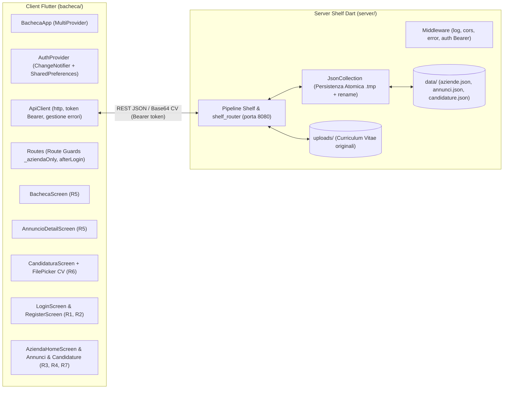

# 📋 Bacheca Annunci di Lavoro (Enterprise Mobile Application Development)
**Docente:** Dott. Sabato Nocera — **Corso:** Enterprise Mobile Application Development (a.a. 2026-2027)  
**Progetto:** Sviluppo di un MVP per la gestione di una bacheca annunci di lavoro.  
**Architettura di Riferimento:** Basata sui template didattici ufficiali del corso (pattern `nytro_server` e `nytro_app`).

---

## 🏛️ 1. Architettura del Progetto

Il sistema è strutturato esattamente secondo i canoni e le convenzioni didattiche fornite per il corso:



### Struttura Directory e File

```
bacheca/
├── lib/
│   ├── config/
│   │   └── api_config.dart          # URL base (http://127.0.0.1:8080) e timeout
│   ├── models/
│   │   ├── azienda.dart             # Modello azienda (id, ragioneSociale, email, settore)
│   │   ├── annuncio.dart            # Modello offerta (id, aziendaId, titolo, descrizione, tags...)
│   │   └── candidatura.dart         # Modello candidatura (nome, email, cvFilename, cvUrl...)
│   ├── providers/
│   │   └── auth_provider.dart       # Sessione, restoreSession con SharedPreferences, login/logout
│   ├── routes.dart                  # Generazione rotte, guard per azienda autenticata, afterLogin
│   ├── screens/
│   │   ├── bacheca_screen.dart             # [R5, S2] Elenco annunci con debounce search e chip
│   │   ├── annuncio_detail_screen.dart     # [R5, S2] Dettaglio annuncio con pulsante candidatura
│   │   ├── candidatura_screen.dart         # [R6, S2] Form candidato con allegato CV (PDF/DOC)
│   │   ├── login_screen.dart               # [R2, S1] Login azienda
│   │   ├── register_screen.dart            # [R1, S1] Registrazione account azienda
│   │   └── azienda/
│   │       ├── azienda_home_screen.dart        # [S1, S3] Dashboard azienda e logout
│   │       ├── azienda_annunci_screen.dart     # [R4, R7] Gestione propri annunci con badge contatore
│   │       ├── azienda_annuncio_form_screen.dart # [R4, S1] Form creazione nuovo annuncio
│   │       └── azienda_candidature_screen.dart   # [R7, S3] Consultazione candidature e download CV
│   ├── services/
│   │   └── api_client.dart          # Client HTTP centralizzato con gestione token e 401
│   ├── utils/
│   │   └── validators.dart          # Validatori form per email, password, campi obbligatori
│   ├── widgets/
│   │   ├── app_drawer.dart          # Drawer laterale di navigazione tra le sezioni
│   │   └── error_view.dart          # Schermate di errore e banner di feedback
│   └── main.dart                    # Inizializzazione MultiProvider, tema Material 3, routing
│
├── server/                          # Backend Dart autonomo (Shelf)
│   ├── bin/
│   │   └── server.dart              # Entrypoint server Shelf, binding porte e pipeline
│   ├── data/                        # File JSON persistiti con JsonCollection
│   │   ├── aziende.json
│   │   ├── annunci.json
│   │   └── candidature.json
│   ├── uploads/                     # Cartella di archiviazione file CV allegati
│   ├── lib/
│   │   ├── controllers/             # AuthController, AnnuncioController, CandidaturaController, AziendaController
│   │   ├── dao/                     # JsonStore, AziendaDao, AnnuncioDao, CandidaturaDao
│   │   ├── errors/                  # ApiException
│   │   ├── middleware/              # AuthMiddleware, ErrorMiddleware, CorsMiddleware
│   │   ├── models/                  # Azienda, Annuncio, Candidatura
│   │   ├── services/                # PasswordService (salt+SHA256), TokenService, Seeder
│   │   └── utils/                   # Validators e formatIsoUtc
│   └── test/
│       └── server_test.dart         # Test suite completa end-to-end del backend
```

---

## 🎯 2. Conformità agli Scenari d'Esame

### Scenario 1 (S1) – Pubblicare un annuncio (R1, R2, R4)
1. L'azienda non ha un account: apre il menù laterale (`AppDrawer`) o preme **"Accesso Aziende"** e seleziona **"Registra Nuova Azienda"** (`RegisterScreen`).
2. Inserisce ragione sociale, settore, email e password. L'app invia la richiesta a `/api/auth/register`, crea l'account in `aziende.json` e ottiene il token di sessione (R1).
3. Esegue l'accesso (`LoginScreen` su `/api/auth/login`): l'app salva il token in `SharedPreferences` ed entra in `AziendaHomeScreen` (R2).
4. Clicca su **"Pubblica Nuovo Annuncio"** (`AziendaAnnuncioFormScreen`), compila titolo, sede, tipologia di contratto, tags e descrizione e conferma.
5. Il server registra l'annuncio in `annunci.json` associandolo all'azienda autenticata (R4). L'annuncio è subito visibile in bacheca.

### Scenario 2 (S2) – Candidarsi a un annuncio (R5, R6)
1. Il candidato apre l'app senza autenticarsi: compare la `BachecaScreen` con tutti gli annunci disponibili (R5).
2. Seleziona un annuncio: si apre `AnnuncioDetailScreen` con la descrizione estesa (R5).
3. Preme **"Candidati a questa posizione"**: si apre `CandidaturaScreen` (R6).
4. Compila nome, cognome, email, messaggio e preme **"Seleziona"** per scegliere il proprio Curriculum Vitae (PDF, DOC, DOCX, TXT).
5. Preme **"Conferma e Invia Candidatura"**: l'app converte il file in base64 e lo invia a `/api/annunci/:id/candidature`. Il server salva il file fisico nella cartella `uploads/` e aggiunge la candidatura in `candidature.json` (R6).
6. Viene mostrato il dialogo di conferma dell'avvenuta ricezione.

### Scenario 3 (S3) – Consultare le candidature e uscire (R7, R3)
1. L'azienda autenticata apre **"I Miei Annunci"** (`AziendaAnnunciScreen`): ogni annuncio mostra il badge con il numero di candidature ricevute (es. *"1 candidatura"*).
2. Seleziona l'annuncio con candidature e preme **"Vedi Candidature"**: si apre `AziendaCandidatureScreen` (R7).
3. L'azienda visualizza nome, cognome, email e data del candidato. Premendo su **"Dettagli"** legge le note motivazionali, mentre premendo **"Apri CV"** apre o scarica direttamente il file del curriculum allegato via `/api/uploads/<filename>`.
4. Nel drawer o nella dashboard seleziona **"Disconnetti (Logout)"**: l'app invia `/api/auth/logout`, elimina il token locale da `SharedPreferences` e reindirizza alla bacheca pubblica (R3). Le aree riservate non sono più accessibili.

---

## 🚀 3. Guida per l'Avvio e il Test

### Passo 1: Avviare il Server Dart (Shelf)
Aprire un terminale:
```powershell
cd server
dart run bin/server.dart
```
Il server si avvierà su `http://127.0.0.1:8080`, caricando i file JSON da `server/data/` (con dati demo iniziali generati dal `Seeder`).

### Passo 2: Avviare l'Applicazione Flutter
In un secondo terminale, dalla radice del progetto:
```powershell
# Esecuzione su Google Chrome (Web):
flutter run -d chrome

# Oppure su desktop Windows:
flutter run -d windows
```

### Passo 3: Eseguire la Suite di Test
```powershell
# Test del Client Flutter:
flutter test

# Test del Server Dart Shelf (con scenari E2E S1, S2, S3):
cd server
dart test
```
Tutti i test passano con successo (`All tests passed!`).
